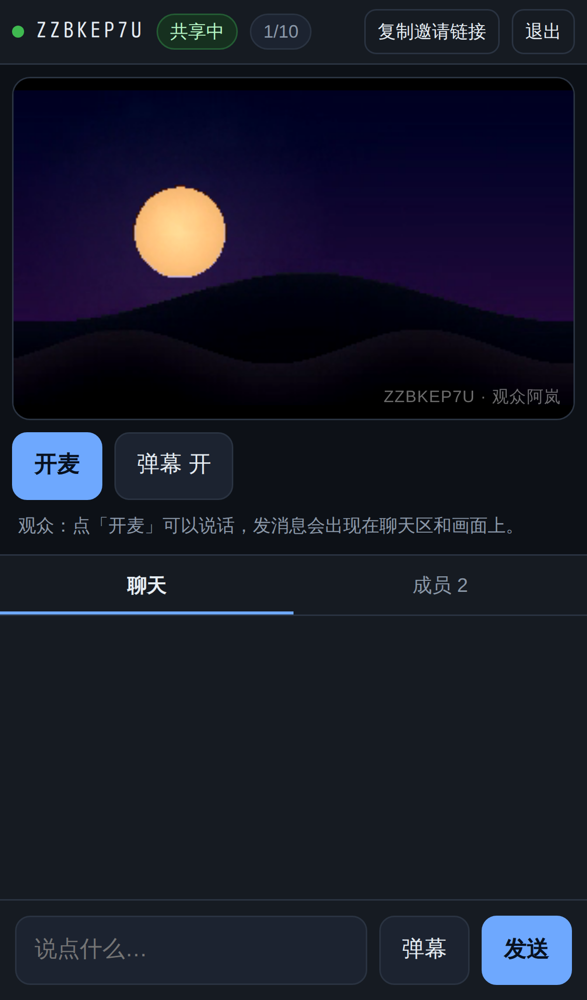
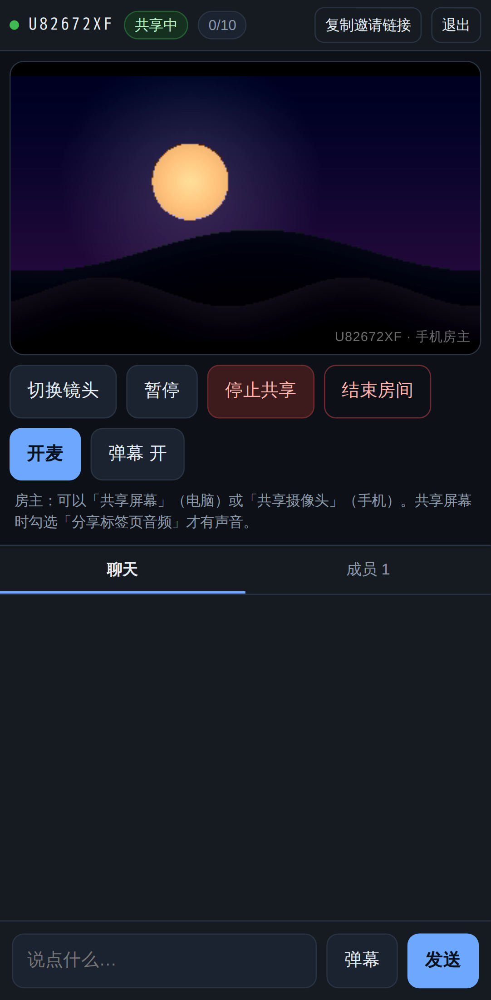
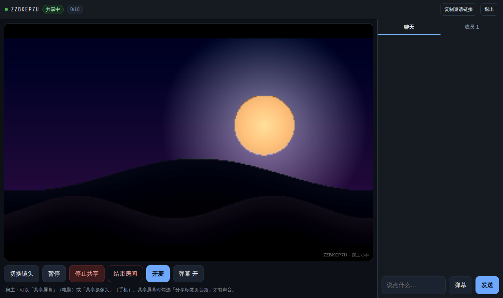

# 手机版使用说明

一个房间里只有两种角色：**房主**（共享画面）和**观众**（看 + 聊）。最多 1 位房主 + 10 位观众。

| 角色 | 设备 | 能共享什么 |
| --- | --- | --- |
| 房主 | 电脑 | 屏幕（标签页 / 窗口 / 整屏，可带系统声音） |
| 房主 | 手机 | 摄像头 + 麦克风（前后可切） |
| 观众 | 手机 / 电脑 | 只需浏览器打开链接 |

手机浏览器（Chrome / Safari / 微信 / 夸克）**都不支持共享屏幕**，这是浏览器安全限制；手机当房主只能用摄像头。

---

## 一、手机当观众

1. 打开房主发来的链接：`https://<网址>/r/CODE`（也可以打开首页手动输入房间码）
2. 填昵称；房间有密码就填密码；点 **加入**
3. 看画面：竖屏自动上下分栏，上面是画面，下面聊天
4. 说话：点底部 **开麦**（默认闭麦，防啸叫）
5. 评论：输入框 → **发送**；弹幕：输入框 → **弹幕**（飘在画面上）
6. 不想看弹幕：点 **弹幕 开** 切成关



---

## 二、手机当房主（摄像头模式）

1. 手机浏览器打开服务地址（自建就是 `https://<电脑IP>:8443`，公网就是隧道/域名地址）
2. 切到 **我要开房** → 填昵称 → **创建并进入**
3. 点 **共享摄像头** → 允许摄像头、麦克风
4. 点 **复制邀请链接** 发给朋友；所有人（含你自己另一台设备）都用这个链接加入
5. 拍后置/前置：点 **切换镜头**
6. 控制：**暂停** / **恢复** / **停止共享** / **结束房间**



只有 HTTPS 或 localhost 才能拿到摄像头/麦克风权限：局域网用自签证书，首次访问点「高级 → 继续前往」。

---

## 三、电脑当房主（屏幕共享）

1. 电脑 Chrome / Edge 打开服务地址
2. 「我要开房」→ 进房后点 **共享屏幕**
3. 选择标签页 / 窗口 / 整屏；**勾选「分享标签页音频」**，否则观众听不到声音
4. 复制链接发人

开共享前有隐私强提示：整屏共享会把通知、微信消息、验证码一起播出去，建议只共享某个标签页。



---

## 四、让别人从外网打开

| 方式 | 适合 | 做法 |
| --- | --- | --- |
| 同一 Wi-Fi | 家里/宿舍 | 直接发 `https://<局域网IP>:8443/r/CODE` |
| 临时隧道 | 临时约几个人看 | 服务器上跑 `./tunnel.sh`，拿到 `https://xxx.trycloudflare.com` 发人 |
| 云服务器 | 长期用 | 部署到 VPS + 正式证书，见 README 第 8 节 |

隧道地址是临时的：进程停、手机关机就失效，重开给的新地址也不一样。

---

## 五、常见问题

| 现象 | 原因 | 处理 |
| --- | --- | --- |
| 进房了但黑屏 | 跨运营商 P2P 打不通 | 自建 TURN（README 第 8 节）；同 Wi-Fi 基本不会 |
| 点「共享摄像头」没反应 | 不是 HTTPS / 权限被拒 | 换 https 地址，浏览器地址栏看权限图标 |
| 手机上看不到「共享屏幕」 | 手机浏览器不支持采屏 | 正常，用「共享摄像头」或换电脑当房主 |
| 提示「人数已满」 | 房间已有 10 位观众 | 等有人退出，或房主换房间 |
| 密码错误 | 密码填错 | 找房主确认；房主可不开密码 |
| 观众听不到声音 | 共享时没勾「分享标签页音频」 | 停止共享 → 重新共享并勾选 |
| 观众说话没声 | 被房主禁言 / 自己闭麦 | 看成员列表的「已禁言」标记 |
| 画面卡、糊 | 房主上行不够 | 减少人数（手机 4G 建议 3–5 人）；或换 WiFi |
| 手机息屏后掉线 | 系统杀后台 | 插电 + 把浏览器加入电池优化白名单 |
| 证书警告 | 自签证书 | 点「高级 → 继续前往」；公网请换正式证书 |

---

## 六、启停与排障

```bash
npm start                 # 启动（默认 8080 / HTTPS 8443）
./start.sh                # 一键：装依赖 + 生成证书 + 启动
./gen-cert.sh             # 重新生成自签证书（换 IP 后要重跑）
./tunnel.sh               # 开临时公网隧道
node test/signaling.test.js && node test/client.test.js   # 自检 67 项
```

- 查服务是否活着：`http://127.0.0.1:8080/healthz` 返回 `ok`
- 查房间信息：`http://127.0.0.1:8080/api/room/CODE` 返回人数与状态
- 手机浏览器打不开局域网地址：确认同一 Wi-Fi、电脑防火墙放行 8443

---

只用于**自有、授权或无版权内容**的私人小范围观看；不要公开转播受版权保护的影视。
